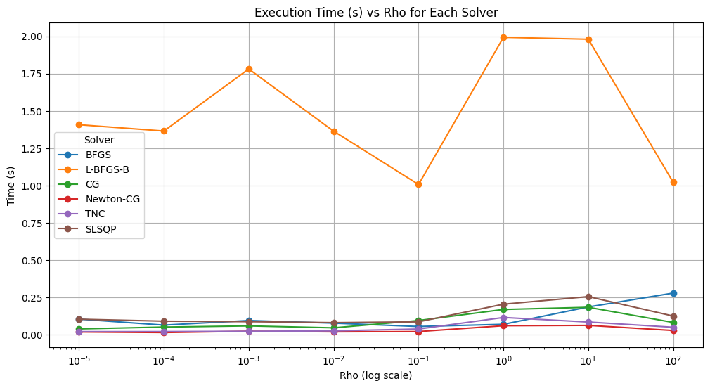
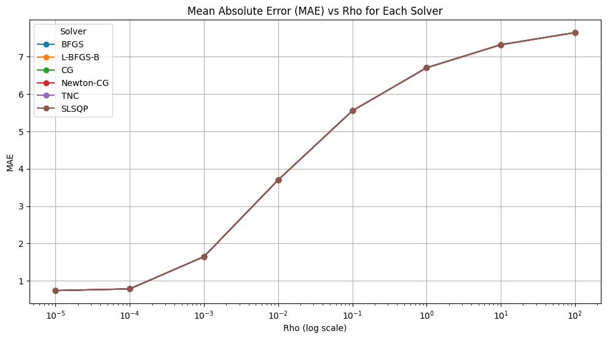
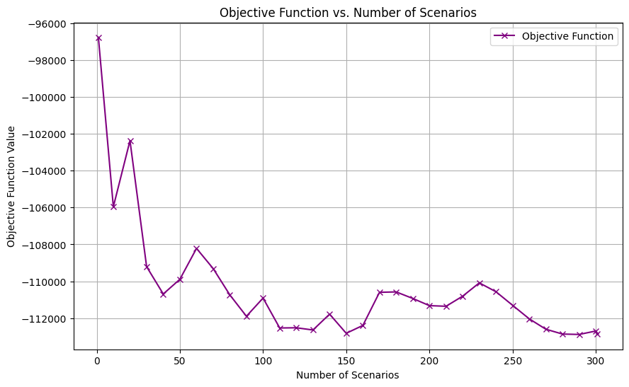

# Nonlinear Solvers for Regularized Regression and a Stochastic Farmer Problem

Benchmark of six SciPy solvers and six hand-written gradient methods on a 150-variable regularized regression, plus a two-stage stochastic farmer model in Pyomo where the stochastic plan beats the deterministic one by a VSS of 899.15.



## The problem
Two questions from numerical optimization. First: when estimating 150 regression coefficients with a fourth-order penalty (rho times the sum of beta to the fourth) or under an equality constraint on the L2 norm, which solvers converge fastest and how does the penalty strength change the fit? Second: how should a farmer split 500 acres between wheat, corn and rice when crop yields are uncertain, and how much is it worth to model that uncertainty instead of planning on average yields?

## Approach
- **Synthetic data**: n = 1500 observations, K = 150 uniform features, true coefficients drawn in [-5, 5], Gaussian noise (seed 42).
- **Regularized regression**: objective (1/n) * sum of squared residuals + rho * sum(beta^4), for rho in {0.00001, 0.0001, 0.001, 0.01, 0.1, 1, 10, 100}, with analytic gradient and Hessian-vector product.
- **SciPy solvers**: BFGS, L-BFGS-B, CG, Newton-CG, TNC and SLSQP from `scipy.optimize.minimize`, compared on iterations, function, gradient and Hessian evaluations, wall time, MAE and R².
- **Custom implementations**: gradient descent, Newton, quasi-Newton, coordinate gradient, mini-batch gradient (batch sizes 32, 64, 128) and a subsampled Hessian-free inexact Newton method (conjugate gradient on a `LinearOperator`).
- **Constrained regression**: the constraint ||beta||_2 = 1 is handled with a quadratic penalization algorithm (Newton-CG, lambda = 100) and directly with SLSQP.
- **Stochastic programming**: two-stage farmer problem in Pyomo solved with GLPK; yields vary uniformly within ±20% of the base yield over 1 to 301 equiprobable scenarios; EVPI and VSS computed from the stochastic, wait-and-see and deterministic solutions.

## Key results
**Solver benchmark** (rho = 0.00001, all six solvers reach R² 0.991126):

| Solver | Iterations | Function evaluations | Time (s) | MAE |
|---|---|---|---|---|
| Newton-CG | 12 | 13 | 0.017914 | 0.741120 |
| TNC | 8 | 30 | 0.020230 | 0.741120 |
| CG | 20 | 50 | 0.038607 | 0.741119 |
| SLSQP | 22 | 24 | 0.103846 | 0.741113 |
| BFGS | 32 | 33 | 0.104392 | 0.741119 |
| L-BFGS-B (no analytic gradient) | 39 | 6946 | 1.407463 | 0.741117 |

- A composite score (0.5 * R² − 0.3 * time − 0.2 * (iterations + function evaluations)) selects **Newton-CG with rho = 0.0001**.
- Regularization strength drives the fit: R² falls from 0.991126 at rho = 0.00001 to 0.059270 at rho = 100 (BFGS), and MAE rises from 0.741119 to 7.638986.
- Constrained regression: the penalization algorithm ends with ||beta||_2 = 1.0095927523804469, SLSQP with 1.0000004815233603; the L2 distance between the two coefficient vectors is 0.012003641787010272.



**Stochastic farmer problem** (301 scenarios):

| Quantity | Value |
|---|---|
| Wheat / corn / rice acres | 134.29 / 85.61 / 280.10 |
| Stochastic solution z* | -112842.91 |
| Wait-and-see solution z_WS | -117812.82 |
| Deterministic (average-yield) solution z_d | -111943.76 |
| EVPI = z* − z_WS | 4969.91 |
| VSS = z_d − z* | 899.15 |



## Stack
Python: NumPy, pandas, SciPy (`optimize`, `sparse.linalg`), scikit-learn (metrics), Matplotlib, Pyomo with the GLPK solver.

## Run it
The notebook was written in Google Colab. Open `Advanced_Optimization_Nonlinear_Uncertainty.ipynb` in Colab and run all cells; the stochastic section installs Pyomo with `pip` and GLPK with `apt-get`. Locally: `pip install numpy pandas scipy scikit-learn matplotlib pyomo`, install GLPK (`glpsol` on the PATH) and remove the two install lines. No external data is needed: all data is generated inside the notebook.

## Repository structure
```
Advanced_Optimization_Nonlinear_Uncertainty.ipynb   full analysis with outputs
figures/                                             key plots extracted from the notebook outputs
LICENSE                                              MIT (code)
```

## Context and authorship
- Built as part of the MSc in Big Data Analytics, Universidad Carlos III de Madrid (2024-2025).
- Individual project.
- Code is released under the MIT License. The project uses no external dataset: the regression data and crop-yield scenarios are generated synthetically in the notebook.

## Author
**Juan del Mazo Vázquez** — [Website](https://juandelmazovazquez.vercel.app) · [LinkedIn](https://www.linkedin.com/in/juan-del-mazo-7500a7276) · [GitHub](https://github.com/JuandelMazoVazquez)

<details>
<summary>Resumen en español</summary>

Comparación de seis solvers de SciPy (BFGS, L-BFGS-B, CG, Newton-CG, TNC, SLSQP) y seis métodos programados a mano (gradiente, Newton, cuasi-Newton, coordenadas, mini-batch y Newton inexacto sin Hessiana) en una regresión de 150 variables con penalización de cuarto orden y con restricción de norma L2. Newton-CG converge en 12 iteraciones y 0.017914 s frente a 6946 evaluaciones y 1.407463 s de L-BFGS-B sin gradiente analítico. La segunda parte resuelve en Pyomo/GLPK el problema estocástico del agricultor con hasta 301 escenarios: EVPI = 4969.91 y VSS = 899.15, es decir, modelar la incertidumbre mejora el plan basado en rendimientos medios.

</details>
